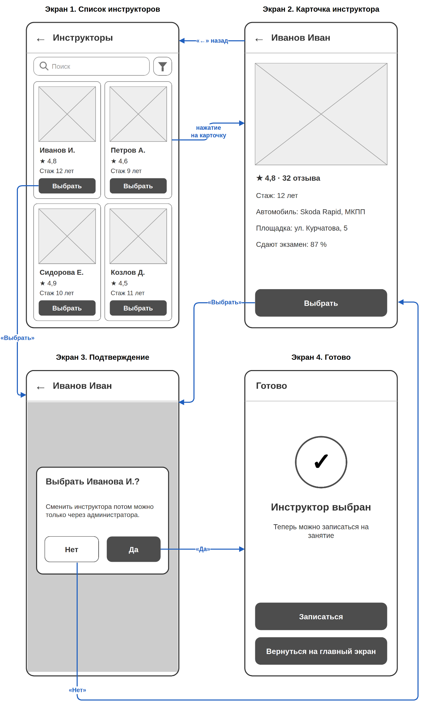

# Прототипы интерфейса

Прототипы экранов мобильного приложения (low-fidelity).

## Сценарий «Выбрать инструктора»

| Экран | Назначение |
|---|---|
| 1. Список инструкторов | Карточки с фото, именем, рейтингом и стажем; поиск и фильтр |
| 2. Карточка инструктора | Рейтинг и число отзывов, стаж, автомобиль и КПП, учебная площадка, процент сдачи, кнопка «Выбрать» |
| 3. Подтверждение | Диалог «Выбрать инструктора?» с кнопками «Да» / «Нет» |
| 4. Готово | Сообщение «Инструктор выбран», переход к записи или на главный экран |
